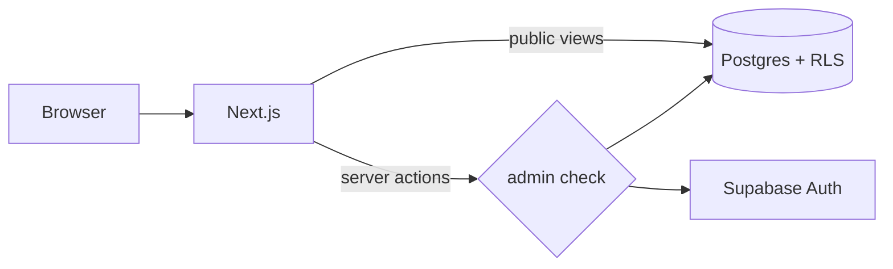

# NISB Digital Archive

*People, leadership and milestones of the IEEE Student Branch, The National Institute of Engineering, Mysuru.*

A searchable archive of NISB office bearers and milestones, with an administration portal for curators. Content is sourced from the official NISB website, and any field without a published source is left empty.

---

## Features

**Public**
- Member directory with search and filters
- Member profiles with role, society, tenure, interests and contributions
- Milestones filtered by society and year, each listing the people involved
- Society pages

**Administration**
- Secure curator sign-in
- Manage members, roles and milestones
- Link people to milestones
- Draft, verify and publish workflow

## Architecture



Public pages read only published, verified records through restricted database views. Every write passes an admin check on the server first.

## Stack

Next.js 16 · React 19 · TypeScript · Tailwind CSS 4 · Supabase (Postgres, Auth) · Zod

## Getting started

Requires Node.js 20.9 or later.

```bash
npm install
cp .env.example .env.local
npm run dev
```

Set `NEXT_PUBLIC_SUPABASE_URL`, `NEXT_PUBLIC_SUPABASE_ANON_KEY` and `SUPABASE_SERVICE_ROLE_KEY` in `.env.local`.

**Database.** In the Supabase SQL editor, run these in order:

1. `supabase/migrations/001_init.sql`
2. `supabase/migrations/002_verified_data_foundation.sql`
3. `supabase/migrations/003_contributions.sql`
4. `supabase/seed.sql`

Files ending in `.down.sql` are rollback scripts and are not part of setup.

**First admin.** Create a user in Supabase Auth, then promote it:

```sql
insert into public.admins (user_id, email, role)
select id, email, 'superadmin'
from auth.users
where email = 'curator@example.org';
```

## Security

- Row-level security on every table
- Public views list their columns explicitly and omit private fields
- Service-role key confined to server-only code
- Admin check on every server action; admin pages fail closed in production

## Quality

```bash
npm test
npm run lint
npx tsc --noEmit
npm run build
```

## Deployment

Vercel for the application, Supabase for data and authentication. Set the three environment variables above in the project settings and never commit `.env.local`.

## Status

Tenure, technical interests, contributions and biographies are added through the admin portal as the committee provides them.
