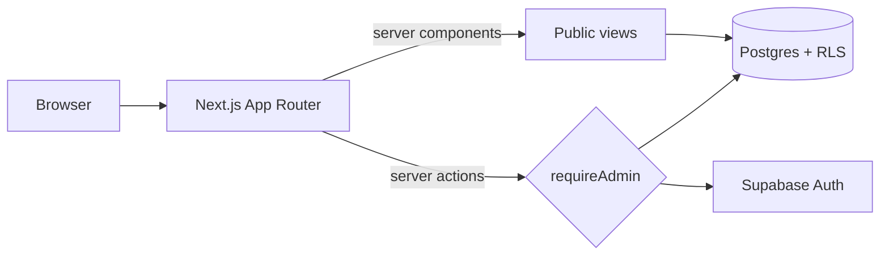

# NISB Digital Archive

## 01 Overview

NISB Digital Archive is a searchable directory of NISB office bearers, with individual profiles, a milestones and achievements section organised by society, and an administration portal for curators.

It is built for students, alumni, committee members and institutional visitors who want to see who has led NISB and what the branch has achieved. Curators maintain the record through the portal; the public site shows only what has been verified and published.

## 02 Data governance

- NISB facts come only from the official page, [nisb.in/content.html](https://www.nisb.in/content.html).
- Names and designations are preserved exactly as published, including the abbreviations MP, IA and MD, which are not expanded.
- Member portraits are the official photographs published by NISB.
- Biographies, tenure, technical interests and contributions are not on the official page, so they stay empty until the committee supplies them. Empty fields are omitted from public pages, never filled with placeholders.
- The seeded roster is the Team section as published. It is loaded as `draft` with verification `source_listed`, and becomes public only when a curator confirms and publishes it.

## 03 Features

**Public archive**

- Member directory with search and filters by society and role tier
- Member profile pages: portrait, designation, society or portfolio, tenure, technical interests, contributions, linked milestones
- Milestones with society and year filters
- Milestone detail pages listing the people involved
- Society pages listing members and milestones; a branch-level roster on the societies index

**Administration**

- Supabase-authenticated login
- Create, edit and delete members and milestones
- Multiple roles per member, each as a branch-level or society-level role with its own years
- Links between members and milestones
- Photograph URLs with live preview
- Draft, verification and publication controls, with confirmation before publishing

## 04 Architecture



Public pages read only through security-barrier views that return published and confirmed records and exclude private columns. Every write goes through a server action that verifies the signed-in user against the `admins` table before touching the database.

## 05 Stack

| Layer | Technology |
|---|---|
| Framework | Next.js 16.4.6 (App Router), React 19.3.0 |
| Language | TypeScript 5 (strict) |
| Styling | Tailwind CSS 4.3.3, Base UI, Lucide |
| Data and auth | Supabase (Postgres with row-level security, Auth), `@supabase/ssr` 0.12 |
| Validation | Zod 4, React Hook Form 7 |
| Quality | ESLint 9, Node.js built-in test runner |
| Runtime | Node.js 20.9 or later |

## 06 Routes

| Route | Purpose |
|---|---|
| `/` | Home |
| `/about` | Archive standards and provenance |
| `/directory` | Searchable member directory |
| `/directory/[id]` | Member profile |
| `/milestones` | Milestones with society and year filters |
| `/milestones/[id]` | Milestone detail |
| `/societies` | Societies and branch-level roster |
| `/societies/[slug]` | Society page |
| `/admin/login` | Curator sign-in |
| `/admin` | Dashboard |
| `/admin/members` | Member management |
| `/admin/milestones` | Milestone management |

## 07 Structure

```text
src/
  app/            routes: public pages and /admin
  components/     admin/ and ui/ (design-system primitives)
  lib/
    archive.ts    public data access (views only)
    actions/      admin server actions
    supabase/     server and browser clients, admin guard
supabase/
  migrations/     001 to 003, applied in order
  seed.sql        official roster and societies
tests/            unit tests
public/assets/    official member portraits
```

## 08 Local setup

Requires Node.js 20.9 or later.

```bash
npm install
cp .env.example .env.local   # Windows PowerShell: Copy-Item .env.example .env.local
npm run dev
```

Set these variables in `.env.local`:

| Variable | Scope |
|---|---|
| `NEXT_PUBLIC_SUPABASE_URL` | Public |
| `NEXT_PUBLIC_SUPABASE_ANON_KEY` | Public |
| `SUPABASE_SERVICE_ROLE_KEY` | Server only. Never expose it. |

Without these, the public pages render in a standby state in development.

## 09 Database setup

In the Supabase SQL editor, run in this order:

1. `supabase/migrations/001_init.sql`
2. `supabase/migrations/002_verified_data_foundation.sql`
3. `supabase/migrations/003_contributions.sql`
4. `supabase/seed.sql`

> Any file ending in `.down.sql` is a rollback script. Do not apply it during normal setup.

## 10 First superadmin

1. In Supabase, open Authentication, add a user, and disable public sign-ups so only invited accounts exist.
2. Promote that user in the SQL editor, replacing the email:

```sql
insert into public.admins (user_id, email, role)
select id, email, 'superadmin'
from auth.users
where email = 'curator@example.org';
```

Roles are `admin` and `superadmin`. No account is created automatically.

## 11 Publication workflow

| Field | Values |
|---|---|
| `status` | `draft`, `published`, `archived` |
| `verification_status` | `pending`, `source_listed`, `confirmed` |

A record appears on the public site only when it is `published` and `confirmed`. Everything else is visible to curators only.

## 12 Security model

- Row-level security is enabled on every table.
- Public reads use views with `security_barrier`. They list their columns explicitly and exclude `source_note` and `updated_by`.
- The service-role key lives only in server-only code (`src/lib/supabase/admin-guard.ts`).
- Every server action calls `requireAdmin()` before validating or writing.
- In production the admin pages fail closed: missing configuration or a non-admin session redirects to `/admin/login`.

## 13 Testing

```bash
npm test
npm run lint
npx tsc --noEmit
npm run build
```

## 14 Deployment

Deploy the application to Vercel and the database to Supabase. Set the three environment variables above in the Vercel project settings; never commit `.env.local`. After deploying, confirm that `/admin` redirects to the login page when signed out.

## 15 Known limitations

- Tenure, technical interests, contributions and biographies are pending committee input.
- No milestones are seeded; curators add them through the portal.
- Profile and milestone URLs use record ids rather than readable slugs.
